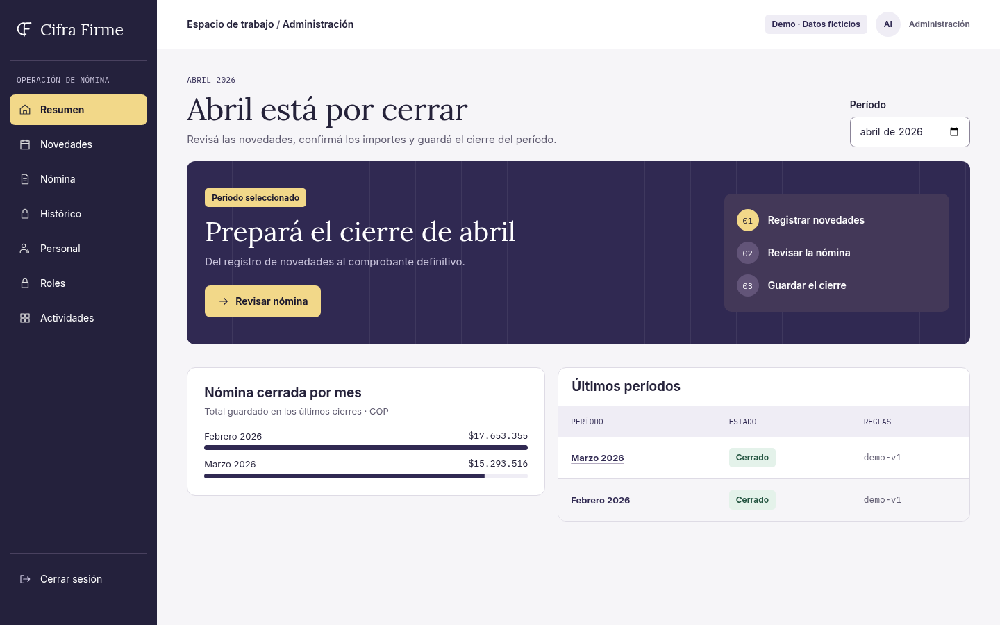

# Cifra Firme

**Una novedad, un cierre, un comprobante que no cambia.** Demo de nómina en COP para explorar cómo se registran novedades, se revisa una liquidación y se conserva el histórico. Trae datos ficticios reproducibles y cuatro perfiles con permisos distintos.



[Probar en local](#probalo-en-local) · [Recorridos por rol](#recorridos-por-rol) · [Pruebas](#pruebas) · [Desplegar en Somee](docs/SOMEE.md)

> **Solo demostración.** `demo-v1` no implementa la normativa laboral colombiana ni ejecuta pagos. No cargues datos reales ni compartas el usuario administrador de una instalación pública.

## Probalo en local

Necesitás **.NET SDK 10**, **Node.js 24 o superior**, npm y Bash. No necesitás Docker ni SQL Server para esta demo.

```bash
git clone https://github.com/nicolas2601/cifra-firme.git
cd cifra-firme
npm --prefix frontend ci
VITE_DEMO=true npm --prefix frontend run build
dotnet dev-certs https
dotnet publish src/Reference.Api -c Release -o .local/demo
(
  cd .local/demo
  read -rsp 'Contraseña para la demo (12–128 caracteres): ' Demo__Password
  printf '\n'
  export Demo__Password
  export Bootstrap__Password="$Demo__Password"
  ASPNETCORE_ENVIRONMENT=Development Database__Provider=Sqlite Database__Initialize=true \
    Bootstrap__Username=admin Demo__Seed=true \
    ConnectionStrings__Payroll='Data Source=cifra-demo.db' \
    dotnet Reference.Api.dll --urls https://localhost:5443
)
```

Abrí **[https://localhost:5443](https://localhost:5443/)**. Si tu navegador no confía en el certificado local, usá `dotnet dev-certs https --trust` donde esté soportado; según el navegador en Linux, puede requerir importar el certificado público en su almacén de confianza. No desactives TLS para un sitio remoto.

Los cuatro perfiles locales usan la contraseña que elegiste. **Explorar con perfiles demo** completa el usuario, no la contraseña. La base queda en `.local/demo/cifra-demo.db`; para repetir abril desde cero usá otro nombre de archivo (y una contraseña nueva si querés). Reiniciar no borra ni duplica datos.

| Datos preinstalados | Qué vas a ver |
| --- | --- |
| 40 personas liquidables, 4 cuadrillas | Norte, Sur, Centro y Occidente, más una persona retirada con histórico. |
| Febrero y marzo de 2026 | Cierres guardados, disponibles en histórico. |
| Abril de 2026 | Abierto. Ana Rivera: $1.800.000 de base, 2 ausencias, 3 incapacidades, 1 día adicional; **$1.695.000 COP** de neto. |
| Roles y actividades | Cuatro roles base, un rol personalizado y ejemplos en los tres estados del tablero. |

## Recorridos por rol

### Administración · `admin`

1. **Resumen:** compará la nómina guardada de los últimos meses. El selector cambia el período que vas a revisar, no los cierres que se comparan.
2. **Novedades:** elegí abril y una persona para registrar, editar o retirar una novedad. La gráfica cuenta tipos de registro de esa persona; el selector solo lista personas con acceso permitido.
3. **Nómina:** revisá abril, mirá la distribución de novedades y abrí el comprobante de Ana Rivera. Seleccioná **Cerrar período → Cancelar** para mantenerlo abierto, o **Confirmar cierre** para guardar sus comprobantes.
4. **Histórico:** abrí abril después de cerrar y descargá el CSV. Cambiá el salario de Ana en **Personal** y volvé al comprobante: seguirá en **$1.695.000**. Si otra sesión cambia un insumo entre la revisión y el cierre, la app exige volver a revisar.
5. **Personal, Roles y Actividades:** agregá o editá una persona, creá un rol personalizado y mové una actividad entre estados editándola. Los gráficos muestran cuentas activas de la página visible, tipos de rol y tareas por estado, respectivamente.

[Captura: revisión de nómina](docs/capturas/03-revision.png) · [Cierre](docs/capturas/05-cierre.png) · [Personal](docs/capturas/11-personal.png) · [Roles](docs/capturas/09-roles.png) · [Kanban](docs/capturas/10-actividades.png)

### Jefatura · `demo-jefa`

En **Mi cuadrilla**, elegí a Ana Rivera. Seleccioná mayo de 2026 y registrá un **Día laborado** el día `2026-05-08`. La gráfica y el listado se actualizan. Intentá repetir la fecha: la API rechaza el duplicado. Podés editar el tipo o retirar el registro en un período abierto. No podés consultar salarios ni ver otras cuadrillas. En **Actividades** solo aparecen las asignadas a tu cuenta.

[Captura: novedad duplicada y gráfica de Ana](docs/capturas/06-conflicto.png)

### Trabajador · `demo-ana`

En **Mis comprobantes**, compará tu neto mensual y abrí febrero o marzo, o abril si ya fue cerrado. El recibo muestra los conceptos y una gráfica de tus novedades guardadas. No podés consultar otro recibo ni exportar el CSV general. **Actividades** muestra solo tus tareas.

[Captura: comparación mensual](docs/capturas/12-trabajador.png) · [Comprobante móvil](docs/capturas/08-recibo-movil.png)

### Contabilidad · `demo-conta`

Entrá a **Períodos cerrados**, compará los importes guardados, abrí un mes y usá **Descargar CSV**. Podés consultar el desglose, pero no cerrar períodos, editar personal o registrar novedades.

[Captura: histórico de Contabilidad](docs/capturas/13-contabilidad.png)

## Cómo funciona

| Pieza | Responsabilidad |
| --- | --- |
| [`frontend/`](frontend/) | React, TypeScript, Vite y TanStack Query. Tablas y gráficas con valores en texto, sin servicio externo de analítica. |
| [`src/Reference.Api/`](src/Reference.Api/) | ASP.NET Core y EF Core. Sirve la web y `/api` en el mismo origen HTTPS. La API autoriza por permiso, persona y cuadrilla. |
| [`src/Reference.Payroll/`](src/Reference.Payroll/) | Motor de cálculo puro, sin dependencia de HTTP ni de base de datos. |
| [`tests/`](tests/) | Cálculo, API, datos iniciales y recorridos completos con Chromium. |

La vista previa devuelve una revisión. Para cerrar, la API verifica esa revisión y guarda cierre, comprobantes y auditoría en una transacción. El histórico, el CSV y las gráficas de meses cerrados leen los comprobantes guardados, no los salarios actuales. El seeder completo se ejecuta solo en **Development + SQLite** y no pisa una base existente.

## Pruebas

```bash
dotnet test -c Release
npm --prefix frontend run lint
npm --prefix frontend run build
# Con Playwright CLI y Chromium instalados:
CIFRA_SHOTS=/tmp/cifra-capturas node scripts/test_frontend.mjs
```

La prueba de navegador crea y borra su propia base y publica en un puerto local separado (`5445` por defecto). No cierra el abril de tu demo. Las capturas del README provienen del recorrido automatizado, que usa 8 personas para acelerar la prueba; la demo local trae 40 por defecto.

[Contrato REST](docs/API.md) · [Reglas de ejemplo](docs/REGLAS-NOMINA.md) · [Backend y configuración](docs/BACKEND.md) · [Despliegue en Somee paso a paso](docs/SOMEE.md)

El código se publica para consulta. No se ha declarado una licencia de redistribución para el proyecto.
